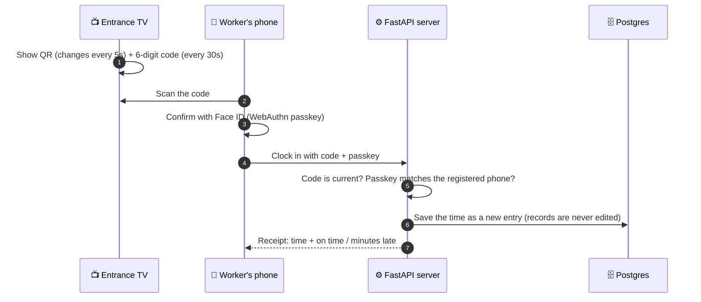
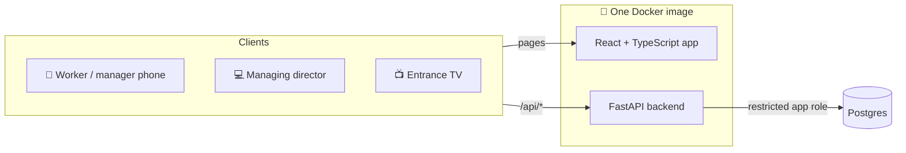

<!-- ░░ HEADER ░░ -->
<p align="center">
  
</p>

<p align="center">
  <a href="https://ceetek1.up.railway.app/">
    
  </a>
</p>

<p align="center">
  <a href="https://ceetek1.up.railway.app/"></a>
  <a href="https://www.linkedin.com/in/chukwurah-charles-652775377"></a>
  <a href="mailto:charles.chukwurah@pau.edu.ng"></a>
</p>

---

### `$ whoami`

```bash
charles@ceetek1:~$ cat about.json
{
  "name":     "Charles Chukwurah",
  "role":     "Software Engineering student @ Pan-Atlantic University (PAU)",
  "focus":    ["AI / Machine Learning", "Backend systems", "Full-stack apps"],
  "status":   "Open to internships and engineering roles",
  "contact":  "charles.chukwurah@pau.edu.ng"
}
```

---

### `$ cat stack.txt`

<p align="center">
  <a href="https://skillicons.dev">
    
  </a>
</p>

---

### `$ ./featured --project officelog`

> **[OfficeLog](https://github.com/ceetek1/officelog)**: a tamper-proof attendance log for workers.
> Scan a rotating QR code at the entrance and confirm with Face ID. Your phone then shows a receipt: on time, or how many minutes late.

<p>
  
  
  
  
  
  
  
</p>

<details>
<summary><b>▶ How a clock-in works</b> (click to expand)</summary>

<br/>



</details>

<details>
<summary><b>▶ How the code is put together</b> (click to expand)</summary>

<br/>



**Engineering decisions I'm proud of:**

- 🧪 **Pure attendance rules.** `app/rules/` never touches the database or the framework, and a test enforces it.
- ⏱️ **Injectable time.** Business code takes a `Clock` instead of calling `datetime.now()`, so tests can replay any moment of any day.
- 🔐 **Server-side roles.** Every endpoint declares its roles, and a test walks every router to check them.
- 📜 **Append-only history.** Paper-sheet corrections are added as new entries, and an activity log records every important action.

📖 [Read the architecture doc →](https://github.com/ceetek1/officelog/blob/main/docs/architecture.md)

</details>

---

### `$ ls ~/projects`

<details>
<summary><b>▶ More things I've built</b> (click to expand)</summary>

<br/>

| Project | What it is | Stack |
| --- | --- | --- |
| [Store_Man](https://github.com/ceetek1/Store_Man) | A command-line key-value store | C++ |
| [mini-ledger](https://github.com/ceetek1/mini-ledger) | Learning how banking systems actually move money | — |
| [movierecomender](https://github.com/ceetek1/movierecomender) | A machine-learning movie recommender (learning project) | ML |
| [visma](https://github.com/ceetek1/visma) | Visitor management: registers visitors, purpose, host, and check-in/out times | — |
| [simi](https://github.com/ceetek1/simi) | Student CGPA planner | — |
| [ConflictBridge_App](https://github.com/ceetek1/ConflictBridge_App) | App project | Python |
| [Tasktion_App](https://github.com/ceetek1/Tasktion_App) | App project | Python |
| [Latonia-website](https://github.com/ceetek1/Latonia-website) | Website | JavaScript |
| [My_portfolio](https://github.com/ceetek1/My_portfolio) | Source for my portfolio site | JavaScript |

</details>

---

### `$ git log --stats`

<p align="center">
  
  
</p>

<p align="center">
  
</p>

<p align="center">
  <picture>
    <source media="(prefers-color-scheme: dark)" srcset="https://raw.githubusercontent.com/ceetek1/ceetek1/output/github-snake-dark.svg" />
    <source media="(prefers-color-scheme: light)" srcset="https://raw.githubusercontent.com/ceetek1/ceetek1/output/github-snake.svg" />
    
  </picture>
</p>

---

### `$ ./contact.sh`

<details>
<summary><b>▶ Recruiter quick-start</b> (click to expand)</summary>

<br/>

```bash
charles@ceetek1:~$ ./contact.sh --help
  --portfolio   https://ceetek1.up.railway.app
  --linkedin    linkedin.com/in/chukwurah-charles-652775377
  --email       charles.chukwurah@pau.edu.ng
  --start-here  github.com/ceetek1/officelog   # best example of my work
```

I'm open to internships and engineering roles. Email is the fastest way to reach me.

</details>

<!-- ░░ FOOTER ░░ -->
<p align="center">
  
</p>
